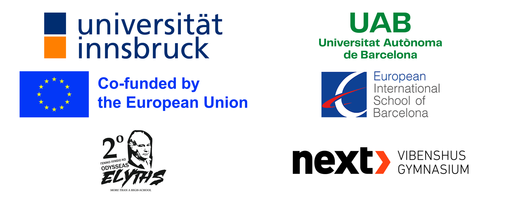

# About the Teaching With AI Project

**Teaching With AI (TAI)** is a project funded by the **Erasmus+ programme of the
European Union**. We develop teaching and learning material for secondary school
students and their teachers, both *about* artificial intelligence and *with* the
use of artificial intelligence.

## What we make

All material on this site is free to use and openly available. It is organised in
three parts:

- **Part 1: AI & Arts and Humanities** - how generative AI creates images, text
  and sound, and what that means for creative work.
- **Part 2: AI & Science** - lessons in physics, mathematics, chemistry, biology
  and robotics, in which students investigate with AI, many of them around eight
  real exoplanets.
- **Part 3: AI & Everyday Life** - in development, expected in the spring of 2027.

Each part has a **student** section with the lesson materials and worksheets, and
a **teacher** section with supporting material, background and practical notes
for running the lessons.

## Using and sharing the material

The material is licensed under the
[Creative Commons Attribution 4.0 International Licence (CC BY 4.0)](https://creativecommons.org/licenses/by/4.0/),
unless otherwise indicated. You may use, share and adapt it, also in your own
learning platform, as long as you credit the Teaching With AI (TAI) project.
Where we build on existing openly licensed work, the source and licence are
credited on the relevant page or in the material itself.

The material is still under development and is being tested in classrooms, so it
will be updated regularly.

## How we used AI

Teaching With AI is a project about artificial intelligence, and we have used AI
ourselves while developing it. We used AI tools to:

- brainstorm ideas for lessons and activities;
- help work out and improve the teaching material, such as worksheets, AI tutor
  prompts and code;
- build and maintain this website;
- check the material for consistency, for example in wording, layout and
  references between files.

We used AI the way we ask students to use it: as a helpful assistant whose output
always needs to be checked. Every lesson was designed by the project team, and
everything AI helped to create was reviewed, edited and, where possible, tested
in classrooms by us. As authors, we take full responsibility for the content of
this project.

## Partners

- Universität Innsbruck (Austria)
- Universitat Autònoma de Barcelona (Spain)
- European International School of Barcelona (Spain)
- 2nd Lyceum of Kos (Greece)
- NEXT Vibenshus Gymnasium (Denmark)

{ width="420" }

## Funding and licence

© 2026 "Teaching in AI" (TAI) Consortium.

This educational material was developed within the framework of the Erasmus+
project "Teaching in AI" (TAI) (2025-1-DK01-KA226-SCH-000365972).

Funded by the European Union.

The views and opinions expressed are those of the author(s) only and do not
necessarily reflect those of the European Union or the granting authority.
Neither the European Union nor the granting authority can be held responsible for
them.

This material is licensed under the Creative Commons Attribution 4.0
International Licence (CC BY 4.0), unless otherwise indicated.
