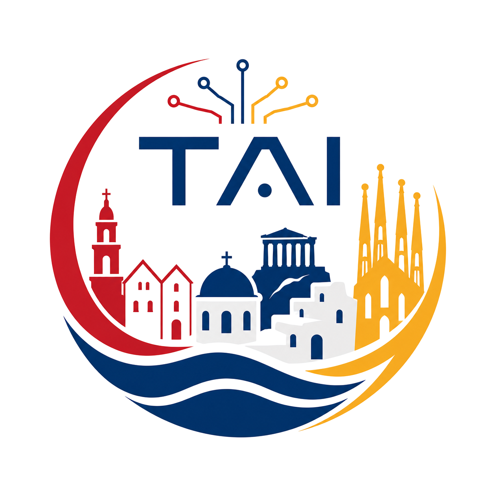
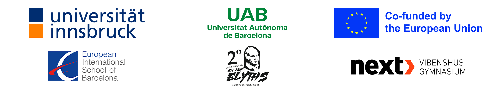

{ .tai-hero-logo }

# Teaching With AI

### Free, open teaching and learning materials about and with artificial intelligence, for students and teachers.

[Browse student materials](for-students/index.md){ .md-button .md-button--primary }
[Browse teacher materials](for-teachers/index.md){ .md-button }

## About the project

Artificial intelligence is changing how we learn, work and create, and it is
already part of students' daily lives. In **Teaching With AI (TAI)**, an Erasmus+
project, two universities and three secondary schools from Austria, Spain,
Greece and Denmark develop lessons that teach students *about* AI, and lessons in
which students learn *with* AI. Students find out how AI works, use it as a tutor,
a research assistant or a creative tool, and learn to look critically at what it
produces: what does AI do well, where does it fail, and who stays responsible for
the result?

The material is organised in three parts, each built around a theme:

- **Part 1: AI & Arts and Humanities**: how generative AI creates text, images
  and sound, and what it means for languages, literature, history and art.
- **Part 2: AI & Science**: AI as an assistant in physics, mathematics,
  chemistry, biology and robotics, with most lessons built around eight real
  exoplanets.
- **Part 3: AI & Everyday Life**: AI in society, from bias and the environment
  to the economy and health (in development).

## Developed together with students

Every part is tested with students during a **testing week** at one of the
partner schools. Students and teachers from the three schools travel to the host
school, stay with host families, and spend a week working on the lessons
together. These exchanges are an important part of the project: students from
different countries learn from and with each other, and their experiences and
feedback directly shape the final material.

-   :material-palette:{ .lg .middle } **Part 1: Copenhagen, April 2026**

    ---

    AI & Arts and Humanities, tested at NEXT Vibenshus Gymnasium in Denmark.

-   :material-telescope:{ .lg .middle } **Part 2: Kos, September 2026**

    ---

    AI & Science, tested at the 2nd Lyceum of Kos in Greece.

-   :material-account-group:{ .lg .middle } **Part 3: Barcelona, spring 2027**

    ---

    AI & Everyday Life, to be tested in the third testing week in Spain.

## Open material for everyone

The aim of the project is to make good teaching material about and with AI
available to every teacher and student, not only to the schools involved. All
material is free to use, share and adapt under a
[CC BY 4.0 licence](https://creativecommons.org/licenses/by/4.0/). Every lesson can
be used on its own, and the material refers to files by name, so you can share it
with your students in any way you like.

!!! info "Who is the material for?"
    The lessons are meant for students in the **last years of secondary school**.
    The students in our testing weeks were between **15 and 18 years old**. Because
    school systems, levels and curricula differ across Europe, please judge for
    yourself whether a lesson fits your class and your curriculum, and adapt it
    where needed. Each lesson page shows the duration, the lesson outline and the
    learning goals to help you decide.

## Explore

-   :material-school:{ .lg .middle } **For Students**

    ---

    Lesson materials, worksheets and guides across our course parts.

    [:octicons-arrow-right-24: For Students](for-students/index.md)

-   :material-human-male-board:{ .lg .middle } **For Teachers**

    ---

    All lesson material, with teacher versions, background and an overview of
    each part.

    [:octicons-arrow-right-24: For Teachers](for-teachers/index.md)

-   :material-head-lightbulb:{ .lg .middle } **AI in the lessons**

    ---

    The different ways in which students use AI in our lessons, with links to
    the lessons that use it.

    [:octicons-arrow-right-24: AI in the lessons](ai-in-the-lessons.md)

-   :material-robot-happy:{ .lg .middle } **AI Tools**

    ---

    Interactive AI tools we built for the classroom, like Emmy, our AI research mentor.

    [:octicons-arrow-right-24: Explore the tools](tools.md)

-   :material-information:{ .lg .middle } **About the project**

    ---

    Who we are, our partners, and how the project is funded by the Erasmus+
    programme of the European Union.

    [:octicons-arrow-right-24: About TAI](about.md)

!!! note "Under development"
    All material on this website is still under development and will be tested and updated regularly.

{ width="620" }

